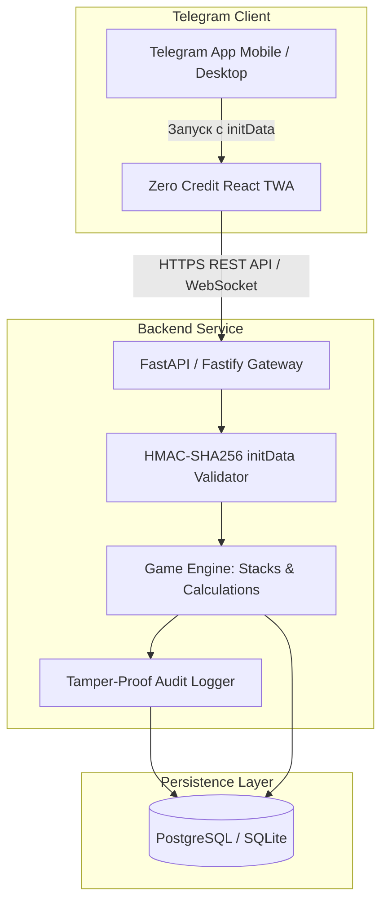

# 🏗 ТЕХНИЧЕСКАЯ АРХИТЕКТУРА: ZERO CREDIT

---

## 1. Обзор Системы

Zero Credit строится по принципу легковесного, высокоскоростного **Telegram Mini App (TWA)**, оптимизированного для работы на смартфонах при слабом интернет-соединении (например, в аудиториях с глушилками или толстыми стенами).



---

## 2. Безопасность и Валидация Telegram `initData`

Приложение не требует паролей или номеров телефонов. Вся идентификация происходит по протоколу Telegram WebApp:

1. Клиент передает строку `window.Telegram.WebApp.initData` в заголовке `Authorization: Bearer <initData>`.
2. Бэкенд проверяет цифровую подпись:
   * Вычисляется $secret\_key = \text{HMAC-SHA-256}(\text{"WebAppData"}, bot\_token)$.
   * Парсится `data_check_string` (все параметры, отсортированные по алфавиту, кроме `hash`).
   * Вычисляется ожидаемый хеш: $\text{HMAC-SHA-256}(secret\_key, data\_check\_string)$.
   * Если хеш совпадает — сессия авторизована, извлекается `telegram_id` и профиль студента.

---

## 3. Web Audio API Engine (Процедурный Звук)

Чтобы приложение запускалось моментально без ожидания загрузки тяжелых audio-файлов (mp3/wav), звуковой движок генерирует все SFX процедурно в реальном времени через встроенный браузерный Web Audio API.

```typescript
// Пример процедурного генератора звука открытия сундука
export class ZeroAudioEngine {
  private ctx: AudioContext;

  constructor() {
    this.ctx = new (window.AudioContext || (window as any).webkitAudioContext)();
  }

  // Щелчок карты при флипе
  playCardFlip() {
    const osc = this.ctx.createOscillator();
    const gain = this.ctx.createGain();
    osc.type = 'triangle';
    osc.frequency.setValueAtTime(320, this.ctx.currentTime);
    osc.frequency.exponentialRampToValueAtTime(80, this.ctx.currentTime + 0.08);
    gain.gain.setValueAtTime(0.3, this.ctx.currentTime);
    gain.gain.linearRampToValueAtTime(0.01, this.ctx.currentTime + 0.08);
    osc.connect(gain);
    gain.connect(this.ctx.destination);
    osc.start();
    osc.stop(this.ctx.currentTime + 0.08);
  }

  // Низкочастотный суб-бас ультимейта "Взгляд Шулера" (55Hz)
  playSubBassDrop() {
    const osc = this.ctx.createOscillator();
    const gain = this.ctx.createGain();
    osc.type = 'sine';
    osc.frequency.setValueAtTime(80, this.ctx.currentTime);
    osc.frequency.exponentialRampToValueAtTime(35, this.ctx.currentTime + 0.6);
    gain.gain.setValueAtTime(0.8, this.ctx.currentTime);
    gain.gain.exponentialRampToValueAtTime(0.001, this.ctx.currentTime + 0.7);
    osc.connect(gain);
    gain.connect(this.ctx.destination);
    osc.start();
    osc.stop(this.ctx.currentTime + 0.7);
  }
}
```

---

## 4. Спецификация REST API

### 4.1. Студент (Игрок)
* `GET /api/me` — Профиль, текущий уровень, $XP$, баланс Жетонов и Отмычек, активный класс.
* `GET /api/inventory` — Список всех собранных предметов с количеством стаков.
* `POST /api/chests/open` — Открытие сундука (`chest_type`: `tent` | `safe` | `joker`, флаг `use_insight`: boolean).
* `GET /api/dailies` — Получение доступных 3 карточных дейликов на день.
* `POST /api/dailies/select` — Выбор активного дейлика на учебный день.
* `POST /api/contracts/take` — Заключение сделки с кардистри («Кредит Нулевого Баланса»).

### 4.2. Боссы и Рейды
* `GET /api/bosses` — Список преподавателей-боссов семестра, их HP и текущий прогресс.
* `GET /api/anomalies/current` — Текущая глобальная аномалия балагана на неделю.

### 4.3. Синдикаты
* `GET /api/syndicates/my` — Информация о бригаде, общий банк, коэффициент синхронизации.
* `POST /api/syndicates/create` — Создание нового синдиката (для лидера).
* `POST /api/syndicates/join` — Вход в синдикат по инвайт-коду.

### 4.4. Журнал Старосты-Арбитра
* `POST /api/arbitrage/attendance` — Пакетная фиксация присутствия на паре (`user_ids: []`, `recitations: []`).
* `POST /api/arbitrage/checkpoint` — Ввод баллов за Контрольную Точку / тест.

### 4.5. Публичный Аудит (Глаз Фемиды)
* `GET /api/audit/logs` — Пагинация неизменяемого журнала академических начислений.
* `POST /api/audit/dispute` — Создание запроса на оспаривание транзакции.
