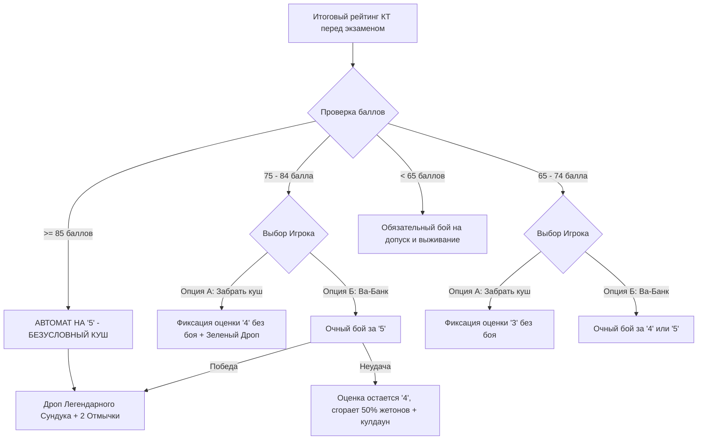
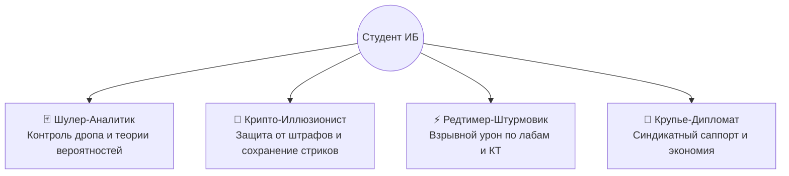

# 📖 GAME DESIGN DOCUMENT (GDD): ZERO CREDIT

---

## 1. Концепция и Сеттинг

* **Жанр:** Session RPG / Roguelike Deck-Builder в формате Telegram Mini App (TWA).
* **Сеттинг:** Кибер-балаган, подпольное казино Таро, эстетика азартных аниме (*Kaiji*, *Kakegurui*, *Akagi*), процедурный аудио-глитч.
* **Главная метафора:**
  * Учебный семестр — это **Забег (Run)**.
  * Дисциплины и преподаватели — **Боссы и Рейды**.
  * Зачетная неделя и сессия — **Финальные схватки за закрытие забега**.
  * Студенческий билет и зачетка — **Колода судьбы и инвентарь реликвий**.

---

## 2. Экономика и Базовые Ресурсы

```text
┌───────────────────────┬────────────────────────────┬──────────────────────────────────────────┐
│ Ресурс                │ Источник получения         │ Назначение                               │
├───────────────────────┼────────────────────────────┼──────────────────────────────────────────┤
│ Фишки Азарта (Hype XP)│ Присутствие на парах       │ Повышение уровня, открытие слотов реликвий│
│ Жетоны Фортуны (Chips)│ Ответы у доски, лабы, квесты│ Покупка сундуков в Шатshell Балагана    │
│ Шутовские Отмычки     │ Победа над КТ и боссами    │ Открытие Сейфов Шулера и Шкатулок Джокера│
│ Очки Синхронизации    │ Командные сдачи синдиката  │ Прокачка гильдейских командных перков    │
└───────────────────────┴────────────────────────────┴──────────────────────────────────────────┘
```

---

## 3. Механика Боссов и Академический Маппинг (АГТУ)

### 3.1. Структура Босс-Файта
Каждый семестровый предмет закреплен за конкретным **Преподавателем-Боссом**:
* **HP Босса:** Базово 100 единиц (соответствует 100 баллам БРС АГТУ).
* **Урон по Боссу:**
  * Сдача лабораторной работы: от $+10$ до $+25$ урона.
  * Успешная Контрольная Точка (КТ): расчетный урон по формуле $Damage = Балл_{КТ} \times Коэффициент_{КТ}$.

### 3.2. Зачеты (Мини-Рейд, 100 HP)
* **$\ge 65$ баллов к зачетной неделе — АВТОМАТ (Insta-Kill):**  
  Босс мгновенно казнен. Выпадает «Зачетный Пак» (опыт, жетоны, гарантированный Зеленый предмет + 1 Отмычка).
* **$< 65$ баллов — Очный бой на зачетной неделе:**  
  Игрок выходит на очный поединок с преподавателем. Сдача тем и долгов конвертируется в урон до отметки 65. Недобор переводит студента в статус **«Хвост»** (дебафф: $-20\%$ к стартовому запасу Жетонов в следующем семестре).

### 3.3. Экзамены (Финальный Босс)
Экзаменационный босс имеет разветвленную матрицу решений:



---

## 4. Система Лута и Формулы Стака (Risk of Rain 2 Progression)

### 4.1. Контейнеры и Шансы Дропа

1. **Обычный Шатер (100 Жетонов Фортуны):**
   * $80\%$ — Белый предмет (Common)
   * $20\%$ — Зеленый предмет (Uncommon)
2. **Сейф Шулера (1 Шутовская Отмычка):**
   * «Горсть Мелочи»: падает $3$–$4$ случайных предмета (Белые и Зеленые в пропорции $60/40$). Идеально для быстрого старта.
3. **Шкатулка Джокера (2 Шутовские Отмычки):**
   * $85\%$ — Красный предмет (Legendary)
   * $15\%$ — Лунарный / Проклятый предмет (Lunar)

### 4.2. Формулы Стаканья Эффектов
Предметы комбинируются по правилам RoR2:
* **Линейный аддитивный стак:** $Effect(n) = Base \times n$ (для множителей урона и валюты).
* **Гиперболический стак (шанс не может превысить 100%):**  
  $$Chance(n) = 1 - (1 - P_{base})^n$$
* **Экспоненциальный мультипликативный стак:** $Mult(n) = Base^n$.

---

## 5. Полный Компендиум Предметов

### ⚪ Белые Предметы (Базовые стаки)
1. **Шутовской Колпак (Jester's Cap):**  
   * *Эффект:* $+10\%$ к выпадению Жетонов за ответы у доски.  
   * *Стак:* Линейный ($+10\%$ за каждый стак: $10\%, 20\%, 30\dots$).
2. **Утяжеленные Кости (Weighted Dice):**  
   * *Эффект:* Шанс удвоить начисленные жетоны за тест/коллоквиум.  
   * *Стак:* Гиперболический ($Chance(n) = 1 - (1 - 0.20)^n$, 1 стак = $20\%$, 2 стака = $36\%$, 3 стака = $48.8\%$).
3. **Кофе Дежурного (Midnight Brew):**  
   * *Эффект:* $+15\%$ к приросту $XP$ за первую утреннюю пару (08:30).  
   * *Стак:* Линейный ($+15\%$ за стак).
4. **Счастливый Грифель (Lucky Pencil):**  
   * *Эффект:* При получении баллов за КТ с вероятностью $10\%$ добавляет $+2$ балла виртуального урона.

### 🟢 Зеленые Предметы (Тактические реликвии)
1. **Рука Шулера (Cardsharp's Sleeve):**  
   * *Эффект:* Сдача лабораторной работы с опережением (в первой тройке сдавших, «с колес» на паре выдачи или в рамках спринта) дает $+20\%$ к урону по следующей Контрольной Точке.  
   * *Стак:* $+15\%$ к урону за каждый дополнительный стак.
2. **Запечатанная Шпаргалка (Sealed Crib):**  
   * *Эффект:* Снижает штраф за 1 пропуск пары в месяц на $100\%$ (пассивный щит посещаемости).  
   * *Стак:* Добавляет $+1$ заряд щита в месяц.
3. **Хронометр Перекура (Cigarette Break Stopwatch):**  
   * *Эффект:* На парах длительностью более 2 пар подряд увеличивает получаемый опыт на $35\%$.

### 🔴 Красные Предметы (Легендарные Арканы)
1. **Карта Дурака (The Fool's Arcana):**  
   * *Эффект:* Перезаряжаемая аркана. Активация в интерфейсе замораживает стрик игрока при получении плохой оценки или незачете самостоялки, предотвращая штрафы. Кулдаун: 14 дней.
2. **Корона Архивариуса (Crown of the Chronicler):**  
   * *Эффект:* Каждый раз, когда кто-то из синдиката сдает лабу, владелец короны получает $25\%$ от заработанных напарником жетонов в виде пассивного роялти.
3. **Печать Экзекутора (Guillotine of ASTU):**  
   * *Эффект:* Существенно снижает пороги автоматической казни босса: зачет закрывается автоматом не при 65, а уже при **51 балле**; экзамен на отлично («5») — при **80 баллах** (вместо 85).

### 🟣 Лунарные Предметы (Проклятая Мощь)
1. **Стеклянный Туз (Glass Ace):**  
   * *Благословение:* Умножает весь получаемый $XP$ за лекции на $3.0\times$.  
   * *Проклятие:* Каждый подтвержденный пропуск пары сжигает $40\%$ от текущего суммарного запаса Жетонов игрока.
2. **Пакт Левиафана (Pact of Leviathan):**  
   * *Благословение:* Все сундуки в магазине становятся на $50\%$ дешевле.  
   * *Проклятие:* Реалистично откалибровано под БРС АГТУ: если итоговый балл за КТ падает ниже $45\%$ от максимума контрольной точки (например, меньше $14$ баллов при стандартном потолке в 30–35 баллов на КТ-1, или меньше $30$ баллов суммарно на КТ-2), накладывается статус «Кризис» (инвентарь замораживается на 7 дней до подтверждения отработки долга).

---

## 6. Классы Персонажей (Архетипы ИБ)

В игре представлено **4 асимметричных класса**, разработанных под разные стили учебы и специализации в сфере Информационной Безопасности.



### 6.1. Шулер-Аналитик (The Cardsharp)
*Специалист по теории вероятностей и манипуляции карточным пулом.*
* **Пассивная способность: «Подсчет Карт» (Card Counting)**  
  Каждое 5-е подтвержденное академическое действие имеет гарантированный критический успех ($+50\%$ к Жетонам или урону).
* **Ультимейт: «Взгляд Шулера» (Cardsharp’s Insight)**  
  * **SFX/VFX:** Монохромный CRT-глитч, щелчок остановки времени, 55 Гц саб-бас.
  * **Artifact of Command:** При открытии сундука генерирует выбор из 3 открытых карт нужной редкости вместо случайного дропа.
  * **Овердрайв (Ставка на КТ):** Прогноз своего результата перед КТ (например, «строго 25+ на КТ-1»). Успех умножает награду в $2.5\times$; провал сжигает поставленные жетоны.

### 6.2. Крипто-Иллюзионист (The Crypto-Illusionist / Cipherpunk)
*Мастер скрытности, стеганографии и нулевого разглашения.*
* **Пассивная способность: «Скрытый Канал» (Covert Channel)**  
  С вероятностью $40\%$ пропуск пары не сбрасывает серию ежедневных посещений (стрик сохраняется за счет «цифрового алиби»).
* **Ультимейт: «Доказательство с Нулевым Разглашением» (ZK-Proof Veil)**  
  * **SFX/VFX:** Волновой эффект шифрования текста (зеленые бегущие символы шестнадцатеричного дампа), мягкий свист синтезатора.
  * **Эффект:** Мгновенно аннулирует штрафы за 1 проваленный тест, опрос или контрольную точку, защищая текущий баланс жетонов и снимая любые негативные статусы («Хвост», «Кризис»).

### 6.3. Редтимер-Штурмовик (The Red-Teamer / Exploit Striker)
*Агрессивный практик-пентестер, пробивающий дедлайны грубой силой.*
* **Пассивная способность: «Эксплойт Нулевого Дня» (Zero-Day)**  
  Любая лабораторная работа, сданная досрочно (в первой тройке или на паре выдачи), наносит $+35\%$ дополнительного чистого урона по здоровью преподавателя-босса.
* **Ультимейт: «Брутфорс-Осада» (Brute-Force Surge)**  
  * **SFX/VFX:** Перегрузка интерфейса красной неоновой вспышкой, звук тревожной сирены и учащенный ритм метронома.
  * **Эффект:** На 7 дней удваивает урон от всех сданных практических заданий. Однако если за эту неделю студент не сдает ни одной работы, персонаж получает статус «Перегрев процессора» (кулдаун на получение жетонов на 3 дня).

### 6.4. Крупье-Дипломат (The Social Engineer / Croupier)
*Мастер социальной инженерии, харизмы и командной выгоды.*
* **Пассивная способность: «Крапленый Сундук» (Marked Deck)**  
  Все сундуки в магазине Балагана стоят на $15\%$ дешевле как для самого Крупье, так и для всех участников его Синдиката.
* **Ультимейт: «Карточный Сговор» (House Collusion)**  
  * **SFX/VFX:** Звон золотых фишек, шуршание раздаваемой колоды, глухой бархатный аккорд джазового фортепиано.
  * **Эффект:** Позволяет перенаправить до $30\%$ избыточного урона одного из участников своей бригады на отстающего сопартийца, спасая его от порога несдачи и подтягивая общий коэффициент синхронизации синдиката.
