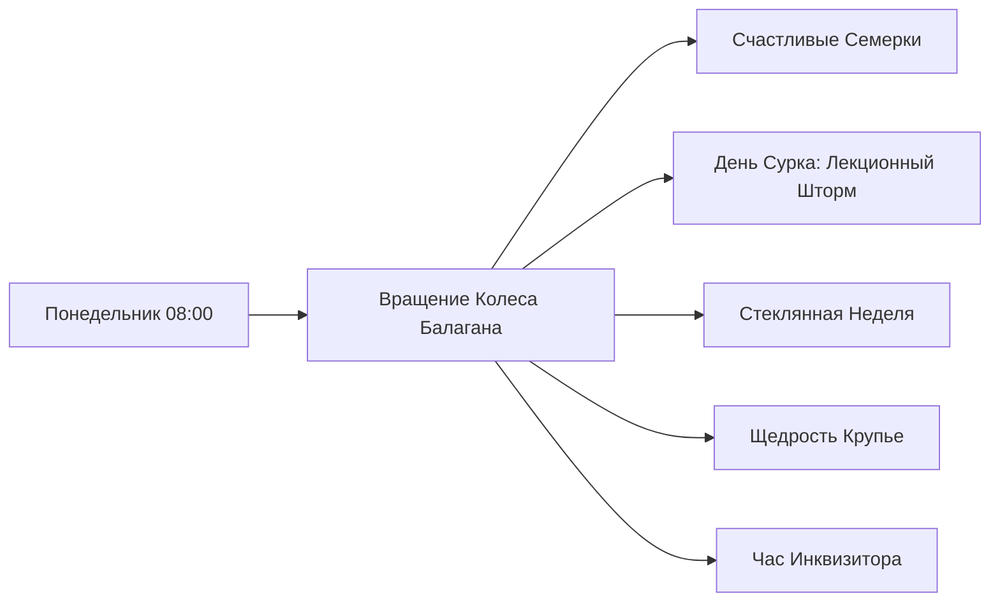
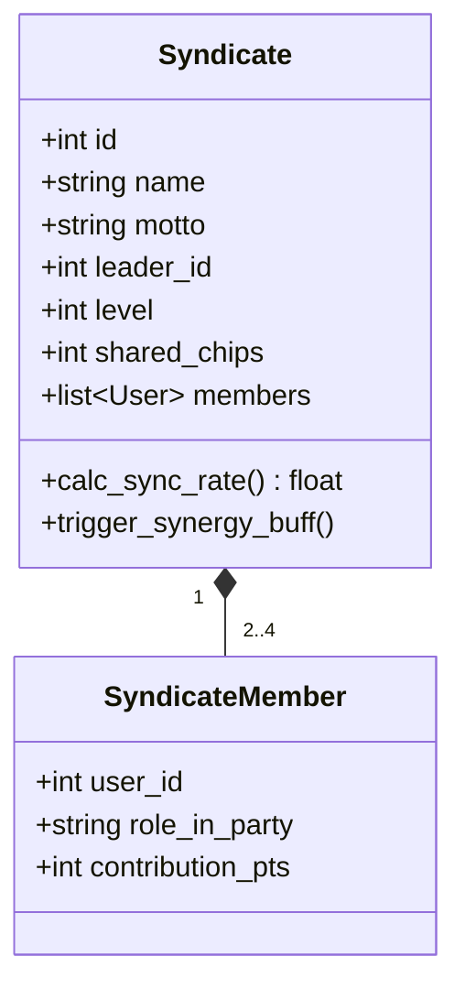
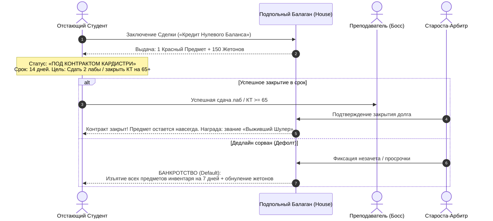
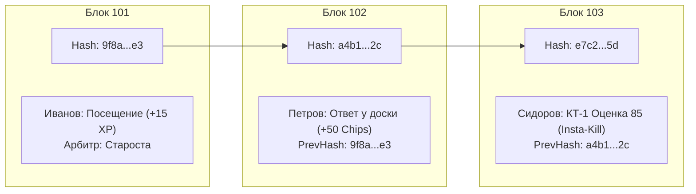

# 🎲 СПЕЦИФИКАЦИЯ МЕХАНИК: ZERO CREDIT

Настоящий документ подробно описывает расширенные игровые системы **Zero Credit**: ежедневные микро-квесты, модификаторы семестра, кооперативные синдикаты, механику отчаянного кредитования и систему публичного аудита.

---

## 1. Карточные Дейлики (Микро-Квесты)

### 1.1. Назначение механики
В реальном учебном процессе между контрольными точками (КТ) могут проходить недели. Без ежедневной активности игроки рискуют потерять интерес к приложению. **Карточные дейлики** создают мгновенный микро-цикл вовлечения на каждой учебной паре.

### 1.2. Механика генерации и выбора
Каждое утро в 07:00 по местному времени система генерирует для каждого студента **3 карты Таро-дейликов** в TWA. 
* Игрок может выбрать **ровно 1 дейлик бесплатно** (или 2 дейлика при наличии активного артефакта «Шутовской Глаз»).
* Выбор фиксируется до конца учебного дня (до 21:00).
* Староста или система валидирует выполнение квеста при фиксации пары.

### 1.3. Таблица Карточных Дейликов

| Карта | Название квеста | Условие в реале | Награда | Штраф при невыполнении |
| :--- | :--- | :--- | :--- | :--- |
| **I. Маг** | *«Дебютный Вопрос»* | Задать лектору или семинаристу профильный вопрос по теме пары (фиксируется старостой в 1 клик) | $+25\%$ к $XP$ за все пары дня | Отсутствует |
| **IV. Император**| *«Спикер Трибуны»* | Выйти к доске для решения задачи или защиты части практики | $+50$ Жетонов Фортуны | Отсутствует |
| **VII. Колесница**| *«Спринтер Лабораторной»* | Сдать лабораторную работу в первой тройке студентов подгруппы/группы | $+1$ Шутовская Отмычка | Отсутствует |
| **XII. Повешенный**| *«Священный Сон»* | Посетить все пары расписания без единого опоздания | $+30$ Жетонов $+ 20$ $XP$ | Пропуск пары сжигает $15$ Жетонов |
| **0. Шут** | *«Провокация Шута»* | Найти неточность/опечатку в задаче лектора или коде на слайде | $+100$ Жетонов $+ 1$ Случайный Белый Предмет | $-30$ Жетонов при ложном замечании |
| **XI. Справедливость**| *«Чистый Протокол»*| Сдать лабораторную работу / отчет преподавателю с первой попытки без правок и возвратов | Реролл сундука в магазине (1 раз бесплатно) | Отсутствует |

---

## 2. Аномалии Балагана (Модификаторы Семестра)

### 2.1. Концепция
Каждый понедельник Балаган крутит **«Колесо Аномалий»**. Выпадает 1 глобальный модификатор, действующий на всю группу с понедельника по субботу. Это меняет стратегию прохождения и оживляет рутину.

### 2.2. Пул Аномалий

1. **«Счастливые Семёрки и Число Дьявола» (Lucky Sevens & Devil's Six)**:
   * **Бафф (Семёрка):** Любая оценка за самостоялку, тест, лабу или балл КТ, заканчивающийся на 7 (например: 7, 17, 27, 37 баллов), удваивает начисленные Жетоны Фортуны ($2.0\times$).
   * **Дебафф (Шестёрка — Число Дьявола):** Любой результат, заканчивающийся на 6 (например: 6, 16, 26, 36 баллов), проклят: начисленные за это событие жетоны срезаются на $50\%$ (в карман крупье Балагана).
2. **«Лекционный Шторм» (Lecture Overdrive)**:
   * Начисление базового $XP$ за присутствие увеличено на $+100\%$. Однако стоимость открытия сундуков в жетонах вырастает на $+25\%$. Неделя фарма уровней!
3. **«Стеклянная Неделя» (Glass Roulette)**:
   * Все награды за ответы у доски и сдачу лаб умножаются на $2\times$. Но каждый пропуск пары списывает $10\%$ от суммарного баланса Жетонов.
4. **«Щедрость Крупье» (Croupier's Grace)**:
   * Шанс выпадения Зеленого предмета из Обычного Шатра увеличен с 20% до 40%.
5. **«Час Инквизитора» (The Inquisitor's Toll)**:
   * Преподаватели наносят ответный урон: не сданная вовремя лабораторная работа на этой неделе накладывает дебафф *«Утомление»* (снижает урон по боссу на следующей КТ на 15%).

---

## 3. Синдикаты (Бригады / Гильдии)

### 3.1. Структура Синдиката
Студенты кафедры ИБ редко сдают сложные практические проекты в одиночку. Синдикаты моделируют лабораторные бригады:
* Численность: **от 2 до 4 человек**.
* Каждый синдикат выбирает **Название**, **Герб (эмодзи/аватар)** и **Девиз**.
* У синдиката есть общий **Банк Реликвий** и показатель **Синхронизации (Sync Rate)**.

### 3.2. Роли в Синдикате
Каждый участник может назначить себе роль в бригаде (дает уникальный командный пассивный эффект):
* 🛡 **Танк-Протокольщик**: Оформляет титульники, отчеты и схемы по ГОСТу.  
  * *Пассивка:* Снижает штраф за просроченный дедлайн для всей бригады на 50%.
* ⚔️ **Кодер-Штурмовик**: Пишет ядро программы, скрипты эксплойтов или криптографические алгоритмы.  
  * *Пассивка:* Первый ответ у доски от штурмовика наносит $+25\%$ урона по боссу.
* 🧠 **Теоретик-Аналитик**: Готовится к каверзным теоретическим вопросам преподавателя.  
  * *Пассивка:* Если аналитик успешно отвечает на контрольный вопрос, вся бригада получает $+20$ Жетонов.
* 🎭 **Шулер-Дипломат**: Ведет переговоры с преподавателем о дате сдачи.  
  * *Пассивка:* Дает +1 бесплатный реролл дейликов для каждого члена синдиката.

### 3.3. Кооперативные Рейды (Групповой урон по боссам)
Когда все члены синдиката закрывают лабораторную работу по предмету в течение одной учебной недели:
* Активируется **«Комбо Синдиката»**: урон по боссу суммируется и умножается на коэффициент синхронизации $1.3\times$.
* В Общий Банк Синдиката падает **«Контрабандный Кейс»** (содержит предметы, которые лидер может распределить между сопартийцами).

### 3.4. Лабораторные Работы Без Фиксированного Срока Сдачи (No-Deadline Mechanics)
На младших курсах у многих преподавателей нет строгой календарной даты дедлайна (сдавать можно хоть до зачетной недели). Чтобы механики досрочности (*«Рука Шулера»*, квесты, баффы синдикатов) работали кристально честно и спортивно, действуют 2 четких триггера скорости:

1. ⚡ **Порядковый Спринт (Первая Тройка)**:  
   «Досрочной» признается сдача в числе первых **3-х студентов подгруппы**, успешно защитивших данную лабораторную работу. Староста фиксирует позицию сдачи в 1 клик.
2. ⏱ **Сдача «С Колес» (Just-in-Time)**:  
   Защита работы непосредственно на той же паре, где выдано задание, либо на первой следующей паре по расписанию — мгновенно активирует статус «Досрочно» независимо от общего числа сдавших.

---

## 4. Сделка с Кардистри (Кредит Нулевого Баланса / Zero Credit)

### 4.1. Философия механики
Механика создана специально для решения проблемы «отстающих студентов». Если студент попал в академическую яму (заболел, пропустил цикл лаб, накопил долги), обычные игры демотивируют его. В Zero Credit он может пойти на **отчаянную сделку с подпольным Балаганом**.

> *«Когда в кармане ноль, а сессия близко — Кардистри протянет тебе туз из рукава. Но помни: долг Балагану отдается кровью и оценками.»*

### 4.2. Условия Контрактов

1. **Контракт «Туз из Рукава» (Лабораторный)**:
   * **Выдача:** Мгновенно выдается Легендарный предмет *«Карта Дурака»* + 150 Жетонов.
   * **Обязательство:** Сдать любые 2 лабораторные работы (или задолженности) за 14 календарных дней либо войти в первую тройку сдающих по новой лабе.
   * **Успех:** Предмет навсегда закрепляется в инвентаре игрока.
   * **Дефолт (Провал):** Инвентарь блокируется на 10 дней, опыт за пары снижается на 50%.

2. **Контракт «Ва-Банк на КТ» (Аттестационный)**:
   * **Выдача:** 3 Шутовские Отмычки прямо сейчас.
   * **Обязательство:** Сдать ближайшую Контрольную Точку на уровень не ниже $75\%$ от её максимального потолка (например: $\ge 24$ баллов при максимуме в 30–35 баллов на КТ-1, или $\ge 50$ баллов суммарно на КТ-2).
   * **Успех:** Удвоение полученных за КТ очков.
   * **Дефолт:** Персонаж получает статус *«Шутовской Колпак Позора»* на 2 недели (профиль отображается в ослиной шапке, все транзакции публично озвучиваются в чате группы).

---

## 5. Публичный Аудит-Лог (Стандарт Информационной Безопасности)

Поскольку разработчики и игроки — студенты кафедры ИБ, система учета должна исключать фактор предвзятости старосты или недоверия группы.

### 5.1. Архитектура Неизменяемого Журнала (Tamper-Evident Ledger)
Каждое академическое действие, подтвержденное Старостой, записывается в публичный журнал `audit_logs` и связывается в криптографическую цепочку (упрощенный аналог блокчейна).

$$Hash_n = \text{SHA-256}(id + user\_id + event\_type + points + timestamp + prev\_hash)$$

### 5.2. Публичная Лента в TWA
В приложении есть раздел **«Глаз Фемиды» (Аудит)**:
* Доступен любому студенту в режиме «только чтение».
* Отображает события в реальном времени: *«[14:15] Староста начислил +1 ответ студенту @username (дисциплина: Криптография)»*.
* **Кнопка «Оспорить транзакцию» (Dispute)**: Если студент считает, что староста ошибся, нажатие кнопки запускает голосование группы (кворум 30% за 24 часа отправляет лог на ручную ревизию Гейм-Мастеру).
