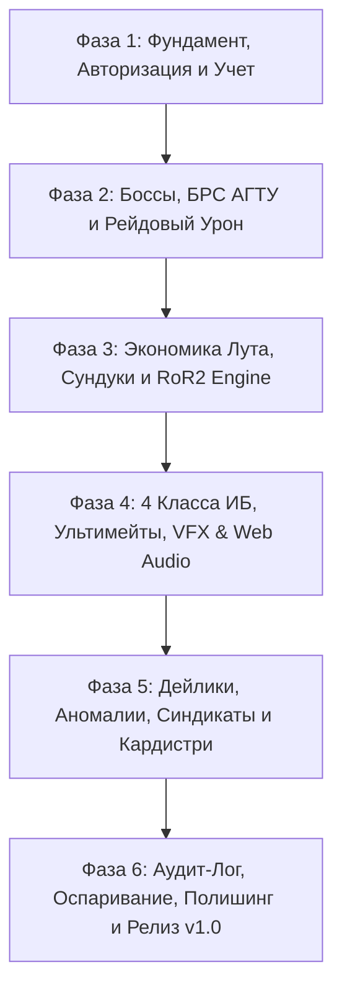

# 🗺 ПОЛНЫЙ ТЕХНИЧЕСКИЙ ROADMAP: ZERO CREDIT (до Release v1.0)

> Дорожная карта разбита на 6 сквозных фаз. Каждая фаза включает в себя от 2 до 4 детально расписанных инженерных задач с обязательной структурой: **«Что»**, **«Как»**, **«Что это даст проекту сейчас»** и **«Что это даст проекту в будущем»**.

---

## 🧭 Общий граф фаз проекта

---

## 🎪 ФАЗА 1: Фундамент, Авторизация и Учет (The Foundation & Arbitrage Core)
*Цель фазы:* Запустить рабочий скелет приложения, реализовать вход через Telegram без логинов/паролей и дать Старосте инструмент учета, который работает быстрее бумажного журнала.

---

### [x] Задача 1.1: Инициализация монорепозитория и каркаса сервисов (ВЫПОЛНЕНО)
* **Что:** Создать структуру каталогов проекта: директория `client/` (Frontend) и `server/` (Backend), настроить конфиги сборки, переменные окружения и зависимости.
* **Как:** 
  * Frontend: `Vite + React 19 + TypeScript + Tailwind CSS`. Настройка абсолютных путей `@/`, подключение `@telegram-apps/sdk`.
  * Backend: `FastAPI (Python 3.11+)` с Pydantic v2 и SQLAlchemy/Aiosqlite, либо `Node.js (Fastify + Prisma)`. Настройка CORS, pre-commit хуков и линтинга (ESLint, Ruff).
* **Что это даст проекту сейчас:** Моментальный старт разработки без конфликтов сборки, единую точку запуска обеих частей проекта одной командой.
* **Что это даст проекту в будущем:** Чистую архитектуру разделения ответственности (Separation of Concerns), легкий перенос с локальной машины на любой VPS-сервер или контейнер Docker.

---

### [x] Задача 1.2: Шлюз авторизации Telegram WebApp (`initData` HMAC-SHA-256) (ВЫПОЛНЕНО)
* **Что:** Реализовать систему аутентификации, которая прозрачно авторизует студента по данным из Telegram-клиента и защищает API от подделки запросов.
* **Как:**
  * На бэкенде: парсинг заголовка `Authorization: Bearer <initData>`, криптографическая проверка HMAC-SHA-256 с использованием секретного ключа бота согласно официальной спецификации Telegram WebApp.
  * Режим разработки: `MOCK_AUTH_MODE=true`, позволяющий тестировать интерфейс в обычном браузере Google Chrome / Firefox без открытия Telegram с подстановкой тестового профиля (Студент / Староста / Гейм-Мастер).
* **Что это даст проекту сейчас:** Безопасный доступ к API; студентам не нужно вводить логины, пароли и номера зачеток — вход происходит мгновенно при открытии TWA.
* **Что это даст проекту в будущем:** 100% соответствие стандартам кибербезопасности, защиту от спама и возможность бесшовного масштабирования на другие группы потока.

---

### [x] Задача 1.3: Интерфейс Старосты-Арбитра («Учет в 2 клика») (ВЫПОЛНЕНО)
* **Что:** Разработать закрытую панель для Старосты, оптимизированную под фиксацию учебной пары прямо во время звонка или перемены со смартфона.
* **Как:**
  * UI-компонент `ArbitrageJournal.tsx`: список группы с фамилиями, большой переключатель «Был / Не был» (по умолчанию все «Был», выключаются только отсутствующие), быстрые кнопки «+Ответ у доски» и «Сдал лабу (в 1-й тройке / с колес)».
  * Кнопка «Зафиксировать пару»: формирует один пакетный POST-запрос на бэкенд `/api/arbitrage/session`, начисляя $XP$ и Жетоны всей группе за одну транзакцию.
* **Что это даст проекту сейчас:** Староста тратит меньше 30 секунд на отметку всей пары, не перегружая себя рутиной и исключая человеческий фактор забывчивости.
* **Что это даст проекту в будущем:** Систематический сбор реальных данных посещаемости без задержек — фундамент для работы всех игровых статов.

---

### [x] Задача 1.4: Дашборд Студента (Профиль и Персональная Статистика) (ВЫПОЛНЕНО)
* **Что:** Сверстать главный экран студента в стилистике подпольного казино: аватар, ранг, шкала $XP$, балансы валют.
* **Как:**
  * Компоненты `PlayerHeader.tsx`, `HypeBar.tsx` (полоска опыта с неоновым свечением), карточки баланса (Жетоны Фортуны, Шутовские Отмычки).
  * Индикаторы уровня: каждый уровень открывает дополнительный слот под экипировку реликвий (максимум 6 слотов к концу семестра).
* **Что это даст проекту сейчас:** Игрок видит плоды каждого своего визита на пары; учебная рутина впервые материализуется в наглядные игровые цифры.
* **Что это даст проекту в будущем:** Центральный хаб приложения, вокруг которого будут наращиваться экраны инвентаря, синдиката и босс-файтов.

---

## ⚔️ ФАЗА 2: Механика Боссов, БРС АГТУ и Рейдовый Урон (Bosses & The Academic Engine)
*Цель фазы:* Интегрировать балльно-рейтинговую систему АГТУ в механику сражения с преподавателями-боссами и реализовать автоматические экзекуты.

---

### Задача 2.1: Модуль Преподавателей-Боссов и Карточки Дисциплин
* **Что:** Разработать модель данных и интерфейс отображения боссов учебного семестра (лекторы, практики, тип аттестации: Зачет или Экзамен).
* **Как:**
  * Сущность `Boss`: имя преподавателя, предмет, HP (100 единиц), статус (Жив / Казнен / В дуэли), портрет в ретро-стиле.
  * Экран `BossesScreen.tsx`: карточки боссов с интерактивной полоской здоровья, иконками слабостей и счетчиком дней до зачетной недели.
* **Что это даст проекту сейчас:** Студенты видят полный академический фронт семестра как цепочку рейдовых подземелий.
* **Что это даст проекту в будущем:** Возможность легкого переключения семестров и добавления новых дисциплин без изменения кодовой базы.

---

### Задача 2.2: Конвертер академических баллов и Контрольных Точек (КТ)
* **Что:** Создать математический движок, преобразующий баллы БРС АГТУ (с учетом специфики КТ-1 и КТ-2) в чистый урон по боссу и генерацию Шутовских Отмычек.
* **Как:**
  * Сервис `AcademicEngine`:
    * Сдача лабораторной работы: $10–25$ урона (с бонусом $+35\%$ при сдаче в первой тройке).
    * Баллы КТ: масштабируются в урон с множителями активных артефактов игрока.
    * Пороги: проверка набора 51 / 65 баллов (зачет) и 80 / 85 баллов (экзамен).
    * Начисление Шутовских Отмычек за победу над мини-боссами (коллоквиумы, закрытые разделы).
* **Что это даст проекту сейчас:** Абсолютную математическую прозрачность: студент точно понимает, сколько HP снимет его оценка за тест.
* **Что это даст проекту в будущем:** Гарантию от рассинхронизации между реальными ведомостями деканата и игровым статусом в TWA.

---

### Задача 2.3: Сессионная дуэль и Экзекуты («Забрать куш vs Ва-Банк»)
* **Что:** Реализовать экран кульминации семестра: анимацию автоматической казни (Insta-Kill) при автомате и диалоговую развилку перед очным экзаменом.
* **Как:**
  * Если к сессии набрано $\ge 85$ (или $\ge 80$ с «Печатью Экзекутора»): экран блокируется кинематографической анимацией падения гильотины, босс повержен, падает Легендарный дроп.
  * Если набрано $65–84$: модальное окно выбора:
    * *Опция А («Забрать куш»):* Зафиксировать текущую оценку (3 или 4), забрать гарантированный лут.
    * *Опция Б («Ва-Банк»):* Выход на очный экзамен с возможностью выбить «5» (при неудаче — штраф к жетонам).
* **Что это даст проекту сейчас:** Превратит стрессовую зачетную неделю в самое захватывающее игровое событие года внутри группы.
* **Что это даст проекту в будущем:** Полноценный эндшпиль для каждого забега (Run) с фиксацией итогового ранга студента в зале славы.

---

## 🎰 ФАЗА 3: Экономика Лута, Сундуки и RoR2 Engine (The Casino Loot & Relics)
*Цель фазы:* Создать захватывающую рогаликовую систему прогрессии предметов с открытием ящиков, карточной распаковкой и честным стаком реликвий.

---

### Задача 3.1: Движок инвентаря и формул стаканья предметов
* **Что:** Реализовать бэкенд и фронтенд логику накопления предметов с расчетом линейных, гиперболических и мультипликативных эффектов.
* **Как:**
  * Модуль `ItemCalculator`:
    * Линейные свойства: `Jester's Cap` ($+10\% \times n$).
    * Гиперболические шансы: `Weighted Dice` ($1 - (1 - 0.20)^n$).
    * Пассивные триггеры: проверка наличия предметов в инвентаре перед любым начислением валюты или урона.
  * UI: `InventoryGrid.tsx` — сетка слотов инвентаря с отображением количества стаков (счетчик $\times 2, \times 3$) и всплывающим тултипом описания.
* **Что это даст проекту сейчас:** Настоящую рогаликовую глубину билдостроения в стиле Risk of Rain 2.
* **Что это даст проекту в будущем:** Возможность бесконечно расширять пул предметов простым добавлением JSON-конфигов без правок движка.

---

### Задача 3.2: Витрина Шатров и Сундуков с анимацией распаковки
* **Что:** Разработать игровой магазин Балагана: Обычный Шатер (за Жетоны), Сейф Шулера и Шкатулку Джокера (за Отмычки).
* **Как:**
  * Компонент `ChestsScreen.tsx` на `Framer Motion`: 
    * Клик по сундуку вызывает покачивание ящика с последующим эффектом разлетающихся золотых искр (CSS/SVG particles).
    * Выпадение карточки предмета рубашкой вверх с плавной 3D-анимацией переворота (Card Flip).
    * Цветовое свечение по редкости: белый, зеленый, рубиново-красный и фиолетово-лунарный.
* **Что это даст проекту сейчас:** Мощнейший эмоциональный отклик и азарт при трате заработанных за лабы жетонов.
* **Что это даст проекту в будущем:** Готовый интерактивный UI-модуль открытия любых типов наград (награды за дейлики, кейсы синдикатов).

---

### Задача 3.3: Реализация компендиума предметов (Белые, Зеленые, Красные, Лунарные)
* **Что:** Запрограммировать все свойства и обработчики событий для стартового набора предметов из GDD.
* **Как:**
  * Программирование логики предметов:
    * *Шутовской Колпак, Утяжеленные Кости, Кофе Дежурного, Счастливый Грифель.*
    * *Рука Шулера* (триггер по первой тройке/сдаче с колес), *Запечатанная Шпаргалка, Хронометр.*
    * *Карта Дурака* (активная аркана с заморозкой стрика), *Корона Архивариуса, Печать Экзекутора (51/80).*
    * *Стеклянный Туз* ($3\times XP$, штраф за пропуск) и *Пакт Левиафана* (скидка $50\%$, кризис при балле ниже $45\%$ от КТ).
* **Что это даст проекту сейчас:** Полностью сбалансированную экосистему лута, где нет бесполезных предметов.
* **Что это даст проекту в будущем:** Идеальный баланс между наградой за старание и риском от лунарных проклятий.

---

## 🔮 ФАЗА 4: Архетипы Персонажей, Ультимейты, VFX & Web Audio (Classes & Sensory Engine)
*Цель фазы:* Внедрить 4 класса специалистов ИБ, их уникальные пассивки и ультимейты, а также оживить приложение процедурным звуком и киберпанк-шейдерами.

---

### Задача 4.1: Интеграция 4-х классов Информационной Безопасности
* **Что:** Добавить выбор и смену специализации персонажа: *Шулер-Аналитик*, *Крипто-Иллюзионист*, *Редтимер-Штурмовик*, *Крупье-Дипломат*.
* **Как:**
  * Экран выбора класса `ClassSelectionModal.tsx` с детальным описанием плейстайла и визуальным стилизованным аватаром.
  * Привязка пассивных свойств:
    * Шулер: каждый 5-й успех критует ($+50\%$).
    * Крипто-Иллюзионист: $40\%$ шанс защиты стрика при пропуске пары.
    * Редтимер: $+35\%$ чистого урона за сдачу лабы в первой тройке сдавших.
    * Крупье: постоянная $15\%$ скидка на все ящики для себя и участников синдиката.
* **Что это даст проекту сейчас:** У каждого студента появляется уникальная роль в коллективе, отражающая его реальный характер и отношение к учебе.
* **Что это даст проекту в будущем:** Разнообразие повторных забегов в следующих семестрах (Replayability).

---

### Задача 4.2: Ультимативные способности и режим «Artifact of Command»
* **Что:** Реализовать активные кнопки ультимейтов для каждого класса с расчетом кулдаунов и уникальной интерактивной логикой.
* **Как:**
  * Шулер: активация *«Взгляда Шулера»* открывает модалку ручного выбора одной из 3 сгенерированных карт (Artifact of Command) либо включает окно предикта на балл КТ.
  * Крипто-Иллюзионист: ультимейт *«ZK-Proof Veil»* аннулирует штраф за неудачный тест.
  * Редтимер: ультимейт *«Брутфорс-Осада»* включает недельный таймер удвоенного урона.
  * Крупье: ультимейт *«Карточный Сговор»* открывает интерфейс передачи урона сопартийцу.
* **Что это даст проекту сейчас:** Тактическое влияние на игровой процесс в критические моменты учебы.
* **Что это даст проекту в будущем:** Глубокую мета-игру, где исход сессии зависит от грамотного тайминга ультимейтов.

---

### Задача 4.3: Синтезатор процедурного звука Web Audio API и Haptic Feedback
* **Что:** Создать легковесный аудио-движок, генерирующий звуки программно на чистом браузере, и интегрировать тактильную отдачу смартфона.
* **Как:**
  * Класс `ZeroAudioEngine`:
    * Синтез звука раздачи карт (треугольная волна с быстрым частотным спадом).
    * Звук ультимейта: низкочастотный саб-бас (55 Гц) с плавным спадом + белый шум бинарного глитча.
    * Золотой звон при начислении жетонов (гармонический синусоидальный аккорд).
  * Подключение `telegram.HapticFeedback`: легкий виброотклик на клик карт, средний на открытие сундука и тяжелый пульсирующий отклик на казнь босса.
* **Что это даст проекту сейчас:** Приложение оживает тактильно и аудиально без задержек на скачивание тяжелых mp3-файлов даже при плохом интернете в аудитории.
* **Что это даст проекту в будущем:** Сохранность трафика и мгновенный cold-start приложения (до 1.5 секунд).

---

### Задача 4.4: VFX-слой в стиле Кибер-Балагана (CRT, Glitch, Neons)
* **Что:** Оформить визуальный стиль TWA: ретро-пиксельные рамки, стилизованные шрифты, монохромный кинематографический шейдер при остановке времени.
* **Как:**
  * Tailwind-тема с кастомной палитрой: глубокий черный (`#0B0C10`), неоновый изумруд (`#45A29E`), золотой балаганный (`#F7B731`) и рубиновый крит (`#E84118`).
  * Canvas-компонент `CRTOverlay.tsx`: легкий эффект сканирующих линий ЭЛТ-монитора и виньетка, активирующиеся при включении ультимейтов.
* **Что это даст проекту сейчас:** Неповторимый, дорогой визуальный облик, выделяющийся на фоне стандартных скучных ботов и веб-страниц.
* **Что это даст проекту в будущем:** Узнаваемый бренд Zero Credit, готовый к презентациям и демонстрации другим группам.

---

## 🤝 ФАЗА 5: Социальные Системы, Дейлики, Синдикаты и Кардистри (The Social Fabric)
*Цель фазы:* Связать студентов группы в единую кооперативную экосистему через бригады, ежедневные микро-квесты и спасательные контракты для отстающих.

---

### Задача 5.1: Движок Карточных Дейликов и Недельных Аномалий
* **Что:** Реализовать ежедневную утреннюю генерацию 3 карт Таро-квестов и еженедельный розыгрыш глобальных модификаторов.
* **Как:**
  * Утренний крон/триггер: генерация карт *«Дебютный вопрос»*, *«Спикер трибуны»*, *«Спринтер лабы (первая тройка)»*, *«Чистый протокол (без правок)»*. Выбор 1 карты в день через `DailyQuestsModal.tsx`.
  * Баннер аномалии на главной странице: автоматическая смена по понедельникам (включая *«Счастливые Семёрки и Число Дьявола»* с баффом на 7 и штрафом 50% на 6).
* **Что это даст проекту сейчас:** 100% ежедневное удержание студентов: есть повод заходить в TWA каждое утро перед парами.
* **Что это даст проекту в будущем:** Постоянное изменение правил игры каждую неделю, исключающее монотонность.

---

### Задача 5.2: Система Синдикатов (Студенческие Бригады по 2–4 человека)
* **Что:** Создать функционал объединения в бригады по лабораторным работам с общим банком и бонусами за командную сдачу.
* **Как:**
  * Модуль `SyndicatesService`: создание синдиката лидером, генерация короткого инвайт-кода, распределение ролей (*Танк-Протокольщик*, *Кодер-Штурмовик*, *Теоретик-Аналитик*, *Шулер-Дипломат*).
  * Логика «Комбо Синдиката»: если вся бригада защищает лабу на одной неделе, их урон по боссу умножается на коэффициент синхронизации ($1.3\times$).
* **Что это даст проекту сейчас:** Стимул сильным студентам подтягивать одногруппников по бригаде ради общего бонуса и лута.
* **Что это даст проекту в будущем:** Превращение группы в сплоченную команду единомышленников.

---

### Задача 5.3: Сделка с Кардистри («Кредит Нулевого Баланса»)
* **Что:** Внедрить систему рискованных контрактов для отстающих студентов, попавших в долговую яму по учебе.
* **Как:**
  * Экран `CardistryDealModal.tsx`: выбор контракта (*«Туз из Рукава»* или *«Ва-Банк на КТ»*). Мгновенная выдача легендарного артефакта или отмычек.
  * Механизм тайм-аута и дефолта: если условия сдачи лаб или КТ не выполнены в срок, срабатывает статус *«Банкротство»* (инвентарь замораживается на 7 дней).
* **Что это даст проекту сейчас:** Спасение троечников от выгорания; игра дает им второй шанс вернуться в строй.
* **Что это даст проекту в будущем:** Ликвидацию проблемы «отсева игроков» к середине учебного семестра.

---

## 🛡 ФАЗА 6: Безопасность, Аудит, Оспаривание и Релиз v1.0 (Audit Ledger & Polish)
*Цель фазы:* Обеспечить абсолютную математическую и криптографическую честность системы, провести сквозное тестирование и выпустить стабильную версию 1.0.

---

### Задача 6.1: Неизменяемый криптографический журнал аудита (SHA-256 Ledger)
* **Что:** Построить систему прозрачного логирования всех академических начислений старосты с хеш-цепочкой (блокчейн-стандарт кафедры ИБ).
* **Как:**
  * Модуль `AuditLedger`: каждая запись в таблице `audit_logs` вычисляет хеш от данных события и хеша предыдущей записи:
    $$Hash_n = \text{SHA-256}(id + user\_id + event\_type + points + timestamp + prev\_hash)$$
  * Экран `AuditScreen.tsx` («Глаз Фемиды»): публичная лента всех событий в реальном времени, доступная любому студенту группы.
* **Что это даст проекту сейчас:** Полное доверие группы к старосте и исключение любых подозрений в подкрутке баллов «друзьям».
* **Что это даст проекту в будущем:** Идеальный портфолио-проект для студентов кафедры ИБ, демонстрирующий применение криптографии в прикладном софте.

---

### Задача 6.2: Механизм Оспаривания Ошибок Старосты (Dispute Resolution)
* **Что:** Дать возможность студентам вежливо оспорить ошибочную или забытую отметку старосты через цивилизованное групповое голосование.
* **Как:**
  * Кнопка «Оспорить» рядом с любым логом или при отсутствии отметки за пару.
  * Создание временного тикета оспаривания. Если за 24 часа 30% группы подтверждают, что студент действительно отвечал/присутствовал, начисление корректируется автоматически.
* **Что это даст проекту сейчас:** Снятие стресса со старосты (ошибки теперь исправляются легко и без скандалов в чате).
* **Что это даст проекту в будущем:** Полную децентрализацию управления и саморегуляцию студенческого сообщества.

---

### Задача 6.3: Комплексное E2E тестирование и PWA/TWA Оффлайн-кэш
* **Что:** Провести стресс-тесты формул урона, интеграционное тестирование API и настроить агрессивное кэширование статических ассетов.
* **Как:**
  * Написание набора unit/integration тестов: проверка формул стаканья предметов RoR2, корректность срабатывания порогов 51/65/80/85, валидация контрактов Кардистри.
  * Настройка Service Worker: локальное кэширование стилей, скриптов и звуковых генераторов для мгновенной загрузки в условиях аудиторий с глушилками связи.
* **Что это даст проекту сейчас:** Полное отсутствие критических багов, фризов и падений во время реального использования группой.
* **Что это даст проекту в будущем:** Надежный фундамент, способный без сбоев отработать полный 4-месячный цикл семестра.

---

### Задача 6.4: Финальный Релиз v1.0 и Ввод в Эксплуатацию
* **Что:** Финальная сборка production-бандла, развертывание на боевом сервере, подключение продакшн Telegram-бота и вводный онбординг для группы ДИБББ-11.
* **Как:**
  * Настройка production-окружения (Docker compose, Nginx, HTTPS-сертификаты, автоматический бэкап базы данных SQLite/PostgreSQL раз в сутки).
  * Инструкция-гайд для старосты и стартовый туториал в TWA при первом входе для студентов.
* **Что это даст проекту сейчас:** Полностью рабочий, протестированный и запущенный боевой продукт версии 1.0, готовый к обслуживанию группы с первого учебного дня.
* **Что это даст проекту в будущем:** Официальную готовность тиражировать Zero Credit на другие группы и институты АГТУ.

---

## 📊 Матрица Готовности Модулей к Релизу v1.0

| Модуль / Подсистема | Фаза | Критерий готовности (Definition of Done) |
| :--- | :---: | :--- |
| **Telegram Gateway & Auth** | 1 | Валидация `initData` по HMAC-SHA-256 + Mock режим для тестов |
| **Журнал Старосты** | 1 | Отметка пары за $\le 30$ секунд в 2 клика |
| **Академический Движок Боссов**| 2 | Пороги автоматов $51 / 65 / 80 / 85$ + казнь Insta-Kill |
| **Инвентарь & RoR2 Лут** | 3 | 3 типа сундуков, формулы аддитивного/гиперболического стака |
| **4 Класса ИБ & Ультимейты** | 4 | Спецумения, режим Command, предикты на КТ |
| **Web Audio & VFX** | 4 | Процедурный синтез звука (щелчки, саб-бас) + Haptics + Glitch |
| **Дейлики & Аномалии** | 5 | Карты Таро на каждый день + недельные баффы/дебаффы (7 и 6) |
| **Синдикаты (Бригады)** | 5 | Пати по 2–4 человека, роли, комбо-урон по боссам |
| **Сделка с Кардистри** | 5 | Кредитование отстающих с механикой дефолта и банкротства |
| **Крипто-Аудит (Глаз Фемиды)** | 6 | Неизменяемая SHA-256 цепочка + публичный просмотр + Dispute |
